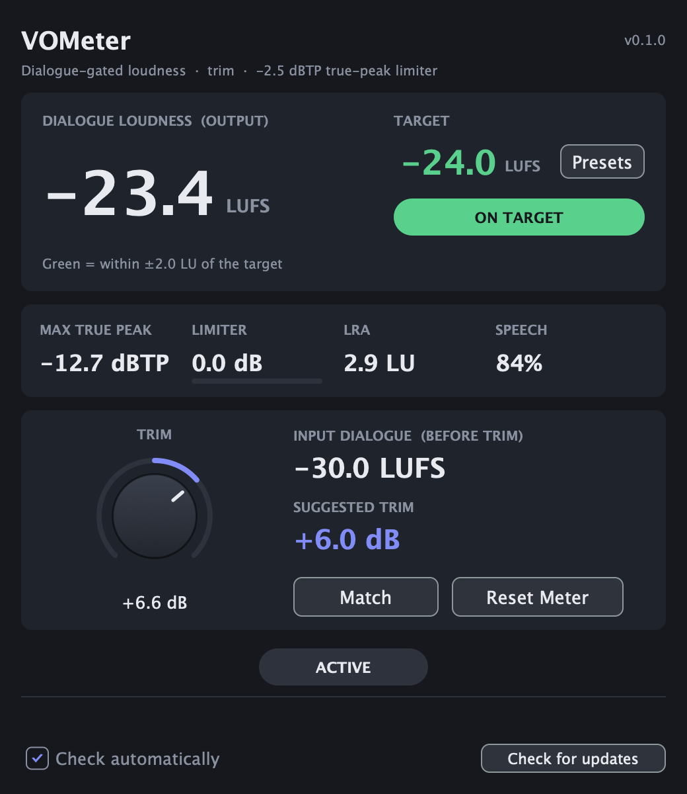

# VOMeter

A loudness finisher for the end of a voice-over track: it measures the **dialogue-gated
integrated loudness** of your VO, tells you how much trim gets it to your delivery target,
and holds the output under **-2.5 dBTP** with a true-peak limiter. It is available as a VST3 on
all platforms, plus an AU on macOS.



Put it last on the narration track. Set the target (-24, -27, ...), play the take through
once, press **Match**, then **Reset Meter** and play it again to confirm: the target turns
green when the dialogue loudness is within ±2 LU of it.

## What it measures

- **Dialogue loudness** follows ITU-R BS.1770 (K-weighting, 400 ms blocks every 100 ms,
  -70 LUFS absolute and -10 LU relative gates), but only blocks that a speech detector marks
  as dialogue count. Pauses, breaths, room tone and steady sounds such as tones or noise beds
  are left out. The detector looks at level above the noise floor, the share of energy in the
  voice band (250 Hz to 3.5 kHz) and the syllable-by-syllable movement of the level. It is
  *not* Dolby Dialogue Intelligence (which is proprietary), so expect small differences from
  Dolby Media Meter on mixed programme. On clean VO the two methods agree closely.
- The meter measures both the **output** (after trim and limiter; the big readout) and the
  **input** (before trim). The input reading gives the suggested trim, so the suggestion stays
  valid after you move the trim.
- It measures **only while the transport plays**. It runs over the whole pass (it is a true
  integrated reading with no time window) until you press Reset Meter.
- On plain BS.1770 the meter agrees with the EBU Tech 3341 test signals and with
  `ffmpeg -af ebur128` to within 0.1 LU.

## Controls

| Control | What it does |
|---------|--------------|
| Target | Dialogue loudness to aim for, -36 to -10 LUFS (default -24). Click the number to type a value, or pick a preset: -23 (EBU R128), -24 (ATSC A/85), -27 (Netflix dialogue). Shown in green when the output is within ±2 LU of it. |
| Trim | Output gain, -18 to +18 dB (default 0). Automatable. **Alt-click** (or double-click) resets it to 0 dB. |
| Match | Sets Trim to the suggested value (target minus the input's dialogue loudness), as one undoable move. |
| Reset Meter | Clears the loudness, max true peak, LRA and speech readings. It doesn't touch the trim. |
| Bypass | Click-free bypass, also linked to your DAW's bypass. It is latency-compensated, so the output is bit-for-bit the input. |

| Readout | Meaning |
|---------|---------|
| Dialogue loudness | Dialogue-gated integrated loudness of the output since the last reset |
| Max true peak | Highest output true peak since the reset (8× oversampled) |
| Limiter | Current gain reduction of the -2.5 dBTP limiter; red while it is working |
| LRA | Loudness range of the output (EBU Tech 3342) |
| Speech | Share of the measured time that counted as dialogue |
| Input dialogue / Suggested trim | Dialogue loudness before the trim, and the trim that would land it on the target (limited to ±18 dB) |

**Limiter:** a stereo-linked lookahead brickwall limiter. It detects inter-sample peaks with
8× oversampling and holds the output at -2.55 dBTP, a 0.05 dB margin so other true-peak meters
agree. It adds about 1.8 ms of latency, which the plugin reports to the host. On normal VO
levels it does nothing until a peak would cross the ceiling.

**Tips**

- If you move the trim (or automate it) during a pass, the output reading mixes the
  settings. The window says so; reset and replay for a clean number.
- If the suggested trim shows "(limit)", the take needs more than ±18 dB. Fix the gain
  earlier in the chain.
- The test tool can measure a real file and render it at a target:
  `VOMeterTest --render take.wav -24 -27` writes `take_VOMeter-24.wav` etc. and prints the readings.

## Install

Download the zip for your system from the
[latest release](https://github.com/kyle95wm/vo-meter/releases/latest), extract it, and run
the included installer, or copy the plugin yourself:

| OS      | Installer             | Manual location |
|---------|-----------------------|-----------------|
| macOS   | `./install.sh`        | `VOMeter.vst3` → `~/Library/Audio/Plug-Ins/VST3`, `VOMeter.component` → `~/Library/Audio/Plug-Ins/Components` |
| Windows | `install.ps1` (right-click → Run with PowerShell) | `VOMeter.vst3` → `C:\Program Files\Common Files\VST3` |
| Linux   | `./install.sh`        | `VOMeter.vst3` → `~/.vst3` |

One-line install of the latest release:

```bash
curl -fsSL https://raw.githubusercontent.com/kyle95wm/vo-meter/main/scripts/install.sh | bash
```

```powershell
# Windows, from an Administrator PowerShell
irm https://raw.githubusercontent.com/kyle95wm/vo-meter/main/scripts/install.ps1 | iex
```

**Logic Pro** only loads Audio Units, so use the AU (`install.sh` installs both). VOMeter
appears under **Audio Units → kyle95wm**, next to the other kyle95wm plugins.

**macOS note:** the builds are ad-hoc signed but not notarised. `install.sh` removes the
quarantine flag for you. If you copy the plugin by hand and macOS blocks it, run
`xattr -dr com.apple.quarantine ~/Library/Audio/Plug-Ins/VST3/VOMeter.vst3` (and the same for the `.component`).

## Updates

The plugin window checks this repo's GitHub Releases (at most once a day) and shows
**Update available** with a Download button when there's a newer version. You can turn off
automatic checks with the *Check automatically* box, or check by hand with *Check for updates*.
The check is a single anonymous request to `api.github.com`. Nothing else is sent.

## Building from source

You need CMake 3.22+, a C++17 compiler, and Git. JUCE is downloaded automatically.

```bash
cmake -S . -B build -DCMAKE_BUILD_TYPE=Release
cmake --build build --config Release --parallel
ctest --test-dir build -C Release --output-on-failure
```

The plugins end up in `build/VOMeter_artefacts/Release/`. Add `-DVO_METER_COPY_AFTER_BUILD=ON`
to install them into your user plug-in folders after each build.

- **macOS:** Xcode or the Command Line Tools. Add `-DCMAKE_OSX_ARCHITECTURES="arm64;x86_64"` for a universal build.
- **Windows:** Visual Studio 2022 or newer with the C++ workload.
- **Linux (Debian/Ubuntu):**
  ```bash
  sudo apt install build-essential cmake git libasound2-dev libjack-jackd2-dev libcurl4-openssl-dev \
    libfreetype-dev libfontconfig1-dev libx11-dev libxcomposite-dev libxcursor-dev libxext-dev \
    libxinerama-dev libxrandr-dev libxrender-dev libglu1-mesa-dev mesa-common-dev
  ```

Options: `-DVO_METER_BUILD_AU=OFF`, `-DVO_METER_BUILD_STANDALONE=ON`, `-DVO_METER_JUCE_PATH=/path/to/JUCE`.

To refresh the README screenshot after changing the UI, build with
`-DVO_METER_BUILD_SCREENSHOT_TOOL=ON` and run
`./build/VOMeterScreenshot_artefacts/Release/VOMeterScreenshot docs/screenshot.png`.

## Releasing

1. Push a tag: `git tag v1.0.0 && git push origin v1.0.0`
2. GitHub Actions builds Windows, macOS (universal) and Linux, runs the tests, and publishes a
   Release with the zips and install scripts. The version inside the plugin comes from the
   tag, so the update checker always compares against the right number.

## License

AGPL-3.0, as required by JUCE's open-source license. VST is a trademark of Steinberg Media Technologies GmbH.
